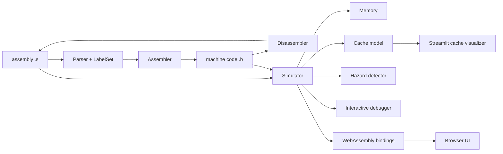

# RISC-V Toolchain & Web Simulator

An assembler, disassembler, interactive debugger and microarchitecture simulator for RISC-V, written in C++17 with no third-party dependencies. The same C++ core compiles to WebAssembly and drives a browser-based simulator.

Built for the Computer Architecture course (CS2323) at IIT Hyderabad.

## Architecture



## What it does

| Component | Description |
|---|---|
| **Assembler** | Assembly text to machine code. R, I, S, B, U and J formats, labels, and the RV64IM mode (`-mode RV64IM`). |
| **Disassembler** | Machine code back to assembly. A full assemble, disassemble cycle returns the original instruction. |
| **Simulator** | Executes a loaded program with registers and byte-addressable memory. |
| **Interactive debugger** | `step`, `run`, up to 5 breakpoints, register and memory dumps, call-stack view (shadow call stack). |
| **Cache simulator** | Configurable size, block size, associativity, FIFO/LRU/RANDOM replacement and write-back/write-through. Per-access hit/miss log and statistics. |
| **Pipeline hazard detector** | Data (RAW/WAR/WAW), control and structural hazards, stall counts, with forwarding on or off. |
| **Web simulator** | The same engine compiled with Emscripten, with an HTML/JS front end. |
| **Cache visualizer** | A Streamlit app comparing hit rates across cache configurations. |

## Quick start

Requires `g++` with C++17 and `make`.

```bash
git clone https://github.com/Rmuk655/RISC-V-Toolchain-Web-Simulator.git
cd RISC-V-Toolchain-Web-Simulator

make build          # builds riscv_sim.exe
make assemble       # assembles Test/complexMul.s
make deassemble     # disassembles Test/complexMul.b
make simulate       # starts the interactive simulator
```

Direct usage:

```text
./riscv_sim.exe -mode RV64IM -a <file.s>     assemble to machine code
./riscv_sim.exe -mode RV64IM -d <file.b>     disassemble
./riscv_sim.exe -mode RV64IM -s              interactive simulator
./riscv_sim.exe -mode RV64IM -t              run all tests
```

On Windows use `mingw32-make` in place of `make`.

## Interactive simulator commands

| Command | Effect |
|---|---|
| `load <file>` | Load an assembly file (resets memory and registers) |
| `show-code` | Show loaded instructions with line numbers |
| `run` / `step` | Run to completion or breakpoint / execute one instruction |
| `regs` | Print all registers in hex |
| `mem <addr> <count>` | Print `<count>` memory values from `<addr>` |
| `show-stack` | Print the call stack |
| `break <line>` / `del break <line>` | Set / remove a breakpoint |
| `cache_sim enable <config>` | Enable cache simulation with a config file |
| `cache_sim disable \| status \| invalidate \| stats \| caches` | Control and inspect the cache |
| `cache_sim dump <file>` | Dump valid cache entries |
| `pipeline enable \| disable \| status` | Control pipeline simulation |
| `pipeline analyze \| hazards \| stalls` | Static analysis, detected hazards, stall statistics |
| `pipeline forwarding <enable\|disable>` | Toggle data forwarding |
| `pipeline dump <file>` / `pipeline clear` | Export analysis / reset |
| `help` / `exit` | Help / quit |

## Cache simulation

A cache configuration file has five lines:

```text
SIZE_OF_CACHE        (number)
BLOCK_SIZE           (number)
ASSOCIATIVITY        (number)
REPLACEMENT_POLICY   (FIFO | LRU | RANDOM)
WRITEBACK_POLICY     (WB | WT)
```

With simulation enabled, a `<program>.log` file records every access:

```text
R: Address: 0x1000000, Set: 0x0, Tag: 0x8000, Clean, Miss, Replacing block in set using INVALID_BLOCK
W: Address: 0x1000000, Set: 0x0, Tag: 0x8000, Dirty, Hit, WB
```

Run several configurations, then compare them with the visualizer:

```bash
pip install -r requirements.txt    # streamlit, pandas, matplotlib (visualizer only)
streamlit run CachesimulatorGUI.py
```

It reports the average hit rate per configuration and can filter by write policy.

## Web simulator

```bash
make websim         # needs the Emscripten toolchain (em++); produces riscv_web.js + .wasm
make serve          # serves http://localhost:8000/index.html
```

## Tests

```bash
make test
```

The suite covers:

1. Unit tests and an assemble, disassemble round trip on standard instructions.
2. The assembler on every `.s` file under `Test/`, compared with `.expect` files.
3. The disassembler on `.b` files.
4. The interactive simulator on `.s` programs (24 programs).
5. The cache simulator (14 configurations) and pipeline hazard detection (17 cases).

The suite is platform independent: path separators in the expected output are normalized, and `RANDOM` cache replacement uses a built-in seeded generator, so results are reproducible on Windows, Linux and macOS.

## Repository layout

| Path | Contents |
|---|---|
| `Assembler.*`, `DeAssembler.*`, `Parser.*`, `LabelSet.*` | Assembly parsing, encoding and decoding |
| `Instruction*.*` , `BitUtils.h` | Instruction set definition and bit helpers |
| `Simulator.*`, `InteractiveSimulator.*`, `Memory.*`, `BreakPointInfo.*`, `ShadowCallStack.*`, `CallFrame.h` | Execution engine, debugger, memory |
| `Cache*.*`, `AddressDecoder.h`, `CachesimulatorGUI.py` | Cache model and visualizer |
| `HazardDetector.*`, `PipelineSimulator.h` | Pipeline hazard analysis |
| `Wasm_bindings.cpp`, `index.html`, `script.js`, `styles.css`, `serve_wasm.py` | WebAssembly bindings and browser front end |
| `TestRunner.*`, `Test/` | Test harness, inputs and expected outputs |
| `Makefile` | `build`, `test`, `assemble`, `deassemble`, `simulate`, `websim`, `serve`, `clean` |

## Supported instructions

R-type: `add sub and or xor sll srl sra`. I-type: `addi andi ori xori slli srli srai` plus loads (`lb lh lw lbu lhu`). S-type: `sb sh sw`. B-type: `beq bne blt bge bltu bgeu`. U/J-type: `lui jal jalr`. Labels are supported, and RV64IM mode adds the M extension (see `Test/ExtensionTests.s` and `Test/Mul64Extn.s`).

## Known limitations and future work

- `ecall`/`ebreak`, pseudo-instructions and assembler directives (`.section`, `.global`, `.data`, `.text`) are not fully supported yet.
- Stack and recursion management is manual: the program lays out its own memory and stack.
- Syntax-error reporting is basic.
- Web UI: breakpoints, memory and cache panels, side-by-side assembly and machine code, inline editing and a hex/decimal register toggle are planned.
- In the interactive simulator, the line number shown with labels is the last executed line.
